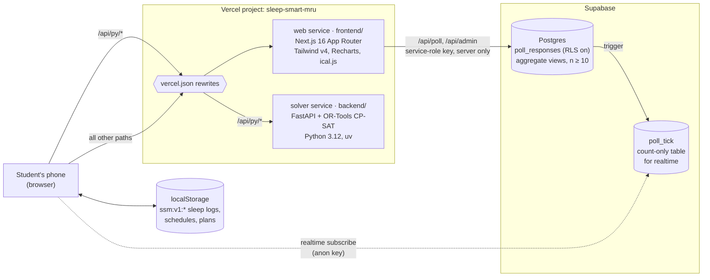

# Sleep Smart MRU

A mobile-first web app that Mount Royal University students open from a poster QR code. It turns
sleep *knowledge* into sleep *action*: an alertness forecast, an exam study planner that never cuts
sleep below 7 hours, an anonymous sleep-barrier poll with a live dashboard, and a sleep guide.

Built for UGST 1002, *Advocating for Change* (Mount Royal University, Calgary, Fall 2026) by
Avalin, Ayan, Liv and Ozzy. Ayan built the app.

**Live:** https://sleep-smart-mru.vercel.app

> Sleep Smart MRU gives educational estimates, not medical advice. It doesn't diagnose sleep
> problems or suggest medication. For health concerns, students can contact MRU Health Services or
> [MRU Wellness Services](https://www.mtroyal.ca/CampusServices/WellnessServices/index.htm)
> (Wellness Centre, U216).

## What's in the app

| Route | What it does |
| --- | --- |
| `/` | Home: the night-sky hero and the four tools |
| `/forecast` | **Sleep Weather.** Log 7 nights, plan tonight, add classes by hand or import an `.ics` calendar, and see tomorrow's alertness every 15 minutes with warnings and a "what if I sleep at…" slider |
| `/forecast/how-it-works` | The alertness model in plain language, with references |
| `/plan` | **Exam-crunch planner.** Up to 14 days, 30-minute slots, never under 7 hours of sleep; exports `.ics` and Google Calendar links |
| `/poll` | **Sleep barrier poll.** Three questions, anonymous, under a minute |
| `/dashboard` | Committee dashboard: live or demo results, passcode-protected reset and reseed |
| `/present` | Full-screen projector view with a QR code to the poll and live updates |
| `/learn` | **Sleep guide.** Habits that help and hurt, a quiz, a sleep-stage chart, a caffeine calculator and 20 studies |
| `/about` | Class context, our pitch, privacy, and the full APA reference list |
| `/status` | System check: confirms the web app and the solver are both running |
| `/api/py/health`, `/api/py/plan` | Solver service (FastAPI) |
| `/api/poll`, `/api/poll/results`, `/api/admin` | Poll routes (Next.js server routes) |

## Architecture

One Vercel project using **Vercel Services (beta)**: a Next.js service and a Python service behind
one domain. `vercel.json` sends `/api/py/*` to the solver and everything else to the web app.



- **No accounts.** Sleep logs, schedules and study plans stay in the browser's localStorage
  (`ssm:v1:*`, validated on load). Only anonymous poll answers go to Supabase.
- **Time zone.** Everything runs in `America/Edmonton` and stores ISO strings with offsets. The
  planner sends the device's own day boundaries (`day_starts`) so phone and server agree even if
  their time-zone databases differ.
- **Poll writes** go only through the Next.js server route with the service-role key. The browser
  reads aggregates only, and subscribes to the count-only `poll_tick` table to know when to refetch.
- **Poll storage modes.** With Supabase keys set, votes go to Supabase. In local dev without keys
  the poll uses memory. In production without keys it answers 503 `not_connected` and never drops
  a vote silently.

## Run it locally

You need Node 22.18 or newer, Python 3.12 with [uv](https://docs.astral.sh/uv/), and the Vercel CLI
(`npm i -g vercel`).

```bash
git clone https://github.com/ayan759/sleep-smart-mru.git
cd sleep-smart-mru
npm --prefix frontend install
(cd backend && uv sync --extra dev)
cp .env.example frontend/.env.local   # then fill in values (see below)
npm run dev:services                  # runs `vercel dev -L` → http://localhost:3000
```

`npm run dev:services` runs both services together, which the planner needs. For front-end-only
work, `npm --prefix frontend run dev` starts Next.js alone; the planner's solver calls won't work
there. (Don't add a root `dev` script that calls `vercel dev`: the CLI detects the recursion.)

To try it on a phone on the same Wi-Fi, open `http://<your-computer's-LAN-IP>:3000`.

## Environment variables

| Variable | Used by | Vercel type | Notes |
| --- | --- | --- | --- |
| `SUPABASE_URL` | server; handed to the browser for realtime | Config | Supabase → Project Settings → API |
| `SUPABASE_ANON_KEY` | server; handed to the browser for realtime | Config | Newer Supabase dashboards call this the **publishable** key. Public by design; RLS protects the data |
| `SUPABASE_SERVICE_ROLE_KEY` | server only | Secret | Newer dashboards call this the **secret** key. Never give it a `NEXT_PUBLIC_` prefix |
| `ADMIN_PASSCODE` | server only | Secret | Protects the dashboard's reset and reload-demo buttons. Choose any long passphrase |

- **Local:** put them in `frontend/.env.local` (under `vercel dev`, the Next.js service reads its
  own folder's env file). The Supabase lines can stay empty locally; the poll then uses memory.
- **Production:** Vercel → project `sleep-smart-mru` → Settings → Environment Variables.
- `.env.example` lists them all. Never commit a real `.env*` file; `.gitignore` blocks them.

### Supabase setup

Follow [`docs/supabase-setup.md`](docs/supabase-setup.md). In short: create a project, run
`supabase/migrations/0001_poll.sql` and then `0002_service_role_grants.sql` in the SQL Editor
(paste the file *contents*), and add the four variables above. New Supabase projects need the
explicit `service_role` grants in `0002`, or inserts fail with `42501 permission denied`.

## Scripts

Run from the repo root:

| Command | What it does |
| --- | --- |
| `npm run dev:services` | Both services locally with `vercel dev -L` |
| `npm run lint` | ESLint + TypeScript check (frontend) and a Python compile check (backend) |
| `npm test` | Vitest (`frontend/lib`) then pytest (`backend/tests`) |
| `npm run build` | Production build of the Next.js app |

Helper scripts in `frontend/scripts/` (run from `frontend/`):

- `node scripts/render-moon.mts` renders `public/moon.webp` (real maria and crater positions,
  deterministic).
- `node scripts/render-icons.mts` renders the favicon, `icon.png` and `apple-icon.png` from the moon.
- `ADMIN_PASSCODE=… node scripts/seed-demo.mts [baseUrl]` reloads the fake **Demo data** poll
  responses, the same as the dashboard button.

## Tests

- **Vitest** covers the alertness model (S, C, W, determinism), the sleep log and chronotype,
  the forecast, `.ics` import, Edmonton time helpers, the planner request and calendar exports,
  poll validation, aggregation and privacy helpers, the sleep guide data and caffeine maths, and
  the APA reference formatting.
- **pytest** covers the solver: sleep never under 7 hours with one block per night, required study
  hours met before each exam, nothing overlapping, a steady wake time, no study in the hour before
  bed, impossible loads returning an explanation (never a crash and never less sleep), deterministic
  output, a 25-hour DST day, and the API's validation (no sleep minimum under 7 h, no window over
  14 days).

## Deploy

Deploys are from the CLI, from the repo root (Vercel isn't connected to GitHub):

```bash
vercel deploy --prod
```

Vercel Services is in beta: re-check the current Vercel docs before changing `vercel.json`. Each
service receives the original path, so every FastAPI route must include the `/api/py` prefix.
Under Services, `/_next/image` isn't routed, so `next.config.ts` sets `images.unoptimized: true`.

## Privacy

- No names, emails, accounts, free-text answers or IP addresses are stored.
- One response per device per poll: a random token in localStorage, stored on the server only as
  a one-way hash.
- Rate limiting uses an HMAC of the IP with a key that rotates daily; buckets are deleted after a
  day. Limits are generous because a whole class shares MRU Wi-Fi.
- Public reads see aggregate views only, and breakdowns appear only for groups of 10 or more.
- Demo data is fake and always labelled "Demo data".

## The science

**Sleep Weather** uses the three-process model of alertness (Åkerstedt & Folkard, 1997): sleep
pressure (S) and the body clock (C) from the two-process model (Borbély, 1982; Daan et al., 1984),
plus sleep inertia (W). The equations and parameter values are the ones restated in the open-access
paper by Ingre et al. (2014); every number in `frontend/lib/alertness.ts` has a comment quoting its
source. The model is pure and deterministic, steps in 15-minute intervals, and maps alertness to a
0–100 index with bands relative to each user's own week. Body-clock timing uses the Munich
ChronoType Questionnaire approach (Roenneberg et al., 2003, 2004).

Still marked `TODO(verify)` in the code, because the original papers weren't readable online:

1. The rule for when sleep recovery slows near the end of the night (breakpoint `bl = 12.2`). It is
   **not** used; recovery is a single exponential.
2. Which mid-sleep time the default 16.8 h body-clock peak assumes. `lib/chronotype.ts` assumes
   03:00 (a typical 11 p.m. to 7 a.m. sleeper).
3. The exact wording of the sleep-corrected mid-sleep (MSFsc) formula.

**The planner** (`backend/app/solver.py`) is a CP-SAT model on 30-minute slots over at most 14
days. Every night has exactly one sleep block of at least 7 hours with a steady wake time, and that
is never relaxed. If the load can't fit, the API returns an explanation and options instead of
cutting sleep. The solver runs deterministically (one thread, interleaved search) with a 5-second
limit.

**The guide** uses Health Canada's caffeine guidance (400 mg a day for adults; energy drinks are
capped at 180 mg per serving) and 20 studies, each summarised in plain words with a link.

**The case for the project.** 33% of MRU students said sleep hurt their academic performance,
beside stress (46%) and anxiety (38%) (NCHA 2019, as reported by MRU Wellness Services, 2021).
Adults need 7 to 9 hours on a consistent schedule (Ross et al., 2020). Sleep knowledge goes with
better habits and better sleep (Brown et al., 2002; Kuhn et al., 2024), but information alone often
doesn't change behaviour (Blunden et al., 2012), while a short, personalized online program did
(50.3% vs 39.5% improved; Hershner & O'Brien, 2018).

### References

APA 7th edition. Generated from `frontend/lib/references.ts`, where each entry was checked against
its Crossref and PubMed record (web pages against the page itself) on 2026-11-24. The same list is
on the app's [About page](https://sleep-smart-mru.vercel.app/about#references).

- Åkerstedt, T., & Folkard, S. (1997). The three-process model of alertness and its extension to performance, sleep latency, and sleep length. *Chronobiology International, 14*(2), 115–123. https://doi.org/10.3109/07420529709001149
- Åkerstedt, T., Folkard, S., & Portin, C. (2004). Predictions from the three-process model of alertness. *Aviation, Space, and Environmental Medicine, 75*(3, Suppl.), A75–A83. https://pubmed.ncbi.nlm.nih.gov/15018267/
- Blunden, S. L., Chapman, J., & Rigney, G. A. (2012). Are sleep education programs successful? The case for improved and consistent research efforts. *Sleep Medicine Reviews, 16*(4), 355–370. https://doi.org/10.1016/j.smrv.2011.08.002
- Borbély, A. A. (1982). A two process model of sleep regulation. *Human Neurobiology, 1*(3), 195–204. https://pubmed.ncbi.nlm.nih.gov/7185792/
- Brown, F. C., Buboltz, W. C., Jr., & Soper, B. (2002). Relationship of sleep hygiene awareness, sleep hygiene practices, and sleep quality in university students. *Behavioral Medicine, 28*(1), 33–38. https://doi.org/10.1080/08964280209596396
- Chang, A.-M., Aeschbach, D., Duffy, J. F., & Czeisler, C. A. (2015). Evening use of light-emitting eReaders negatively affects sleep, circadian timing, and next-morning alertness. *Proceedings of the National Academy of Sciences, 112*(4), 1232–1237. https://doi.org/10.1073/pnas.1418490112
- Daan, S., Beersma, D. G., & Borbély, A. A. (1984). Timing of human sleep: Recovery process gated by a circadian pacemaker. *American Journal of Physiology–Regulatory, Integrative and Comparative Physiology, 246*(2), R161–R183. https://doi.org/10.1152/ajpregu.1984.246.2.R161
- Drake, C., Roehrs, T., Shambroom, J., & Roth, T. (2013). Caffeine effects on sleep taken 0, 3, or 6 hours before going to bed. *Journal of Clinical Sleep Medicine, 9*(11), 1195–1200. https://doi.org/10.5664/jcsm.3170
- Ebrahim, I. O., Shapiro, C. M., Williams, A. J., & Fenwick, P. B. (2013). Alcohol and sleep I: Effects on normal sleep. *Alcoholism: Clinical and Experimental Research, 37*(4), 539–549. https://doi.org/10.1111/acer.12006
- Exelmans, L., & Van den Bulck, J. (2016). Bedtime mobile phone use and sleep in adults. *Social Science & Medicine, 148*, 93–101. https://doi.org/10.1016/j.socscimed.2015.11.037
- Health Canada. (2025, April 2). *Caffeine in foods*. Government of Canada. https://www.canada.ca/en/health-canada/services/food-nutrition/food-safety/food-additives/caffeine-foods.html
- Health Canada. (2026, November 20). *Caffeinated energy drinks*. Government of Canada. https://www.canada.ca/en/health-canada/services/food-nutrition/supplemented-foods/caffeinated-energy-drinks.html
- Hershner, S. D., & Chervin, R. D. (2014). Causes and consequences of sleepiness among college students. *Nature and Science of Sleep, 6*, 73–84. https://doi.org/10.2147/NSS.S62907
- Hershner, S., & O'Brien, L. M. (2018). The impact of a randomized sleep education intervention for college students. *Journal of Clinical Sleep Medicine, 14*(3), 337–347. https://doi.org/10.5664/jcsm.6974
- Ingre, M., Van Leeuwen, W., Klemets, T., Ullvetter, C., Hough, S., Kecklund, G., Karlsson, D., & Åkerstedt, T. (2014). Validating and extending the three process model of alertness in airline operations. *PLOS ONE, 9*(10), Article e108679. https://doi.org/10.1371/journal.pone.0108679
- Kredlow, M. A., Capozzoli, M. C., Hearon, B. A., Calkins, A. W., & Otto, M. W. (2015). The effects of physical activity on sleep: A meta-analytic review. *Journal of Behavioral Medicine, 38*(3), 427–449. https://doi.org/10.1007/s10865-015-9617-6
- Kuhn, T., Karsan, S., Heisz, J. J., & Middleton, L. E. (2024). The differing relationships between academic discipline, sleep hygiene, and dysfunctional sleep attitudes on sleep quality and duration in Canadian university students. *Frontiers in Psychology, 15*, Article 1396579. https://doi.org/10.3389/fpsyg.2024.1396579
- Lund, H. G., Reider, B. D., Whiting, A. B., & Prichard, J. R. (2010). Sleep patterns and predictors of disturbed sleep in a large population of college students. *Journal of Adolescent Health, 46*(2), 124–132. https://doi.org/10.1016/j.jadohealth.2009.06.016
- Mednick, S., Nakayama, K., & Stickgold, R. (2003). Sleep-dependent learning: A nap is as good as a night. *Nature Neuroscience, 6*(7), 697–698. https://doi.org/10.1038/nn1078
- National Institute of Neurological Disorders and Stroke. (2025, February 25). *Brain basics: Understanding sleep*. National Institutes of Health. https://www.ninds.nih.gov/health-information/public-education/brain-basics/brain-basics-understanding-sleep
- Okano, K., Kaczmarzyk, J. R., Dave, N., Gabrieli, J. D. E., & Grossman, J. C. (2019). Sleep quality, duration, and consistency are associated with better academic performance in college students. *npj Science of Learning, 4*, Article 16. https://doi.org/10.1038/s41539-019-0055-z
- Phillips, A. J. K., Clerx, W. M., O'Brien, C. S., Sano, A., Barger, L. K., Picard, R. W., Lockley, S. W., Klerman, E. B., & Czeisler, C. A. (2017). Irregular sleep/wake patterns are associated with poorer academic performance and delayed circadian and sleep/wake timing. *Scientific Reports, 7*, Article 3216. https://doi.org/10.1038/s41598-017-03171-4
- Roenneberg, T., Kuehnle, T., Pramstaller, P. P., Ricken, J., Havel, M., Guth, A., & Merrow, M. (2004). A marker for the end of adolescence. *Current Biology, 14*(24), R1038–R1039. https://doi.org/10.1016/j.cub.2004.11.039
- Roenneberg, T., Wirz-Justice, A., & Merrow, M. (2003). Life between clocks: Daily temporal patterns of human chronotypes. *Journal of Biological Rhythms, 18*(1), 80–90. https://doi.org/10.1177/0748730402239679
- Ross, R., Chaput, J.-P., Giangregorio, L. M., Janssen, I., Saunders, T. J., Kho, M. E., Poitras, V. J., Tomasone, J. R., El-Kotob, R., McLaughlin, E. C., Duggan, M., Carrier, J., Carson, V., Chastin, S. F., Latimer-Cheung, A. E., Chulak-Bozzer, T., Faulkner, G., Flood, S. M., Gazendam, M. K., . . . Tremblay, M. S. (2020). Canadian 24-Hour Movement Guidelines for Adults aged 18–64 years and Adults aged 65 years or older: An integration of physical activity, sedentary behaviour, and sleep. *Applied Physiology, Nutrition, and Metabolism, 45*(10, Suppl. 2), S57–S102. https://doi.org/10.1139/apnm-2020-0467
- Thacher, P. V. (2008). University students and the “all nighter”: Correlates and patterns of students’ engagement in a single night of total sleep deprivation. *Behavioral Sleep Medicine, 6*(1), 16–31. https://doi.org/10.1080/15402000701796114
- Van Dongen, H. P. A., Maislin, G., Mullington, J. M., & Dinges, D. F. (2003). The cumulative cost of additional wakefulness: Dose-response effects on neurobehavioral functions and sleep physiology from chronic sleep restriction and total sleep deprivation. *Sleep, 26*(2), 117–126. https://doi.org/10.1093/sleep/26.2.117
- Williamson, A. M., & Feyer, A.-M. (2000). Moderate sleep deprivation produces impairments in cognitive and motor performance equivalent to legally prescribed levels of alcohol intoxication. *Occupational and Environmental Medicine, 57*(10), 649–655. https://doi.org/10.1136/oem.57.10.649
- Wittmann, M., Dinich, J., Merrow, M., & Roenneberg, T. (2006). Social jetlag: Misalignment of biological and social time. *Chronobiology International, 23*(1–2), 497–509. https://doi.org/10.1080/07420520500545979
- Yoo, S.-S., Gujar, N., Hu, P., Jolesz, F. A., & Walker, M. P. (2007). The human emotional brain without sleep—A prefrontal amygdala disconnect. *Current Biology, 17*(20), R877–R878. https://doi.org/10.1016/j.cub.2007.08.007

The MRU figures (NCHA 2019, as reported by MRU Wellness Services, 2021) come from the project
brief; we couldn't find a public copy of that report to link to.

## Project docs

- [`docs/step-0-proposal.md`](docs/step-0-proposal.md): the original plan
- [`docs/sleep-weather-presenter-guide.md`](docs/sleep-weather-presenter-guide.md): how to explain
  Sleep Weather in the presentation
- [`docs/demo-script.md`](docs/demo-script.md): the 3-minute live demo
- [`docs/supabase-setup.md`](docs/supabase-setup.md): database setup
