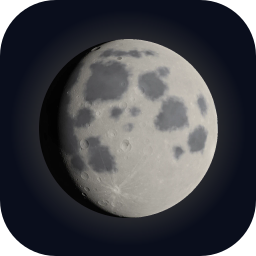
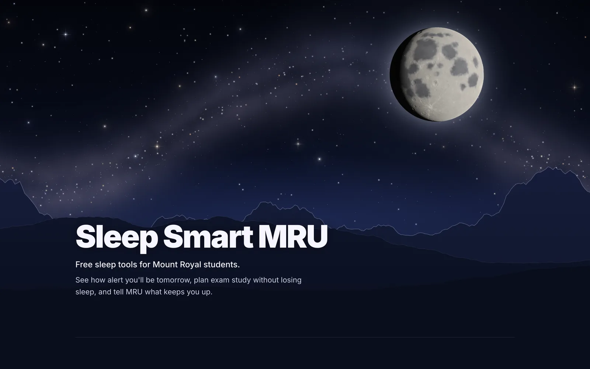
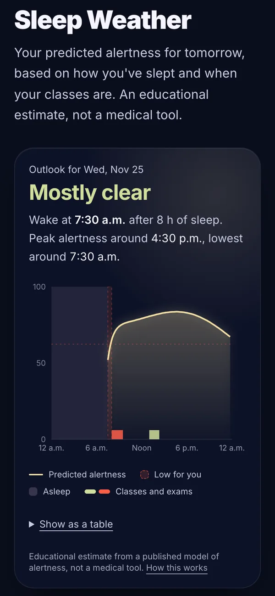
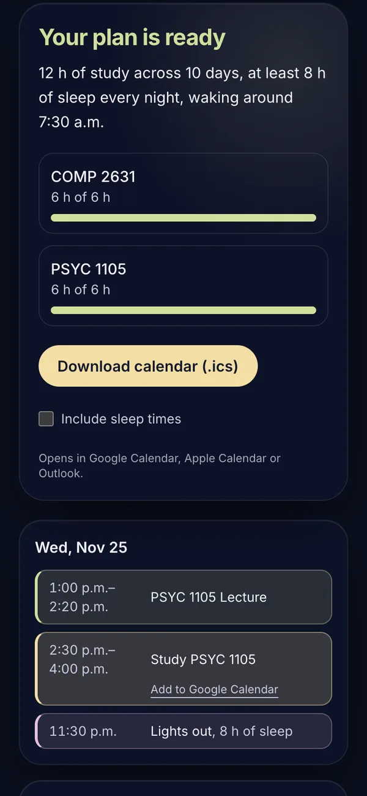
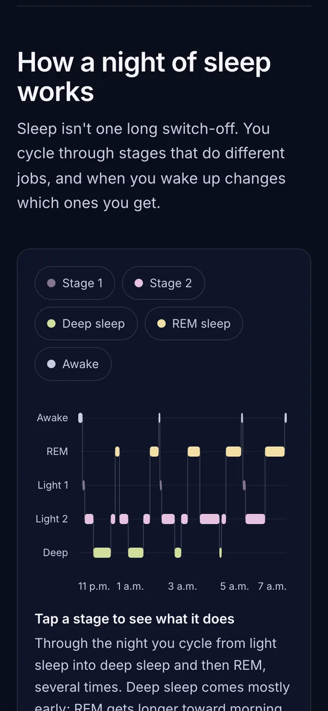
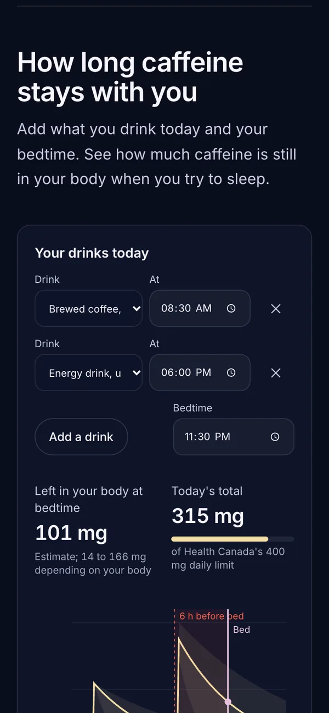
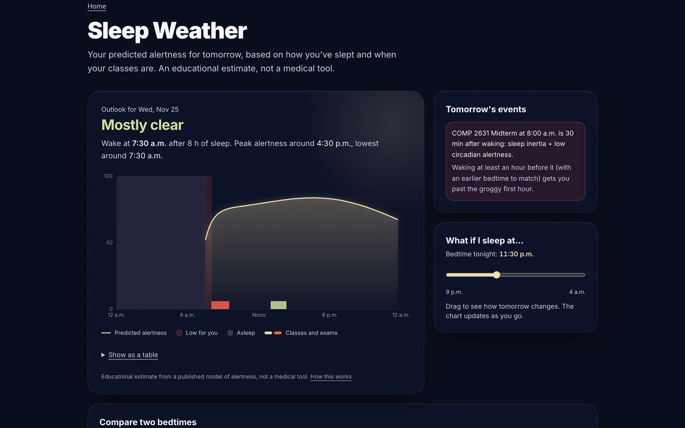
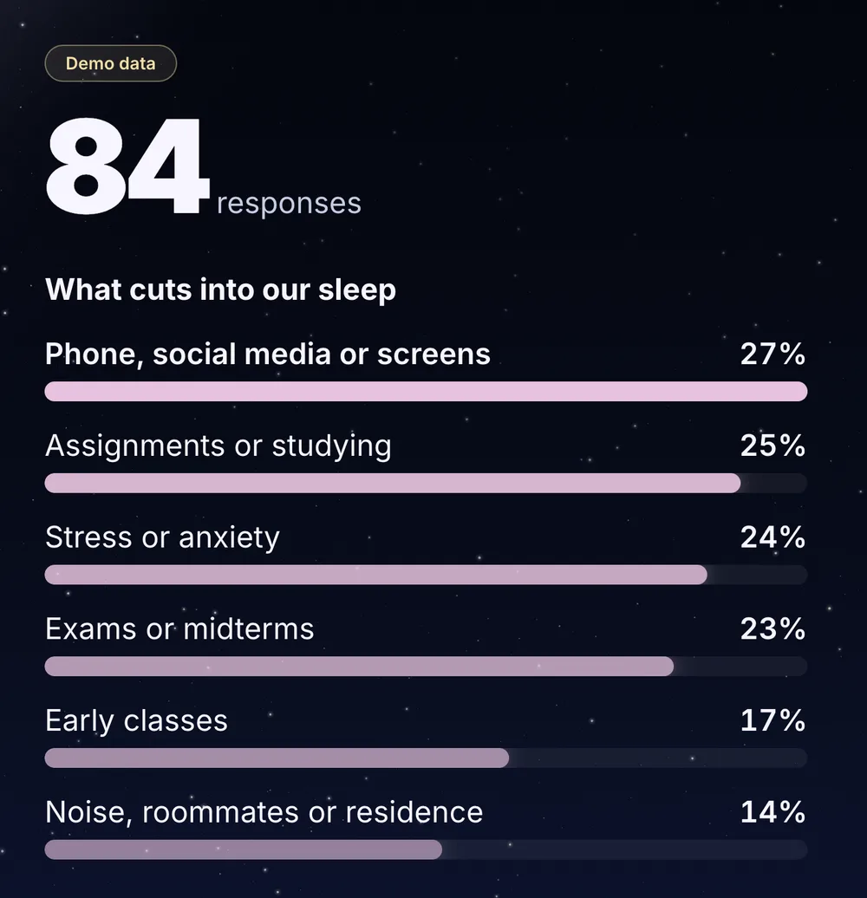
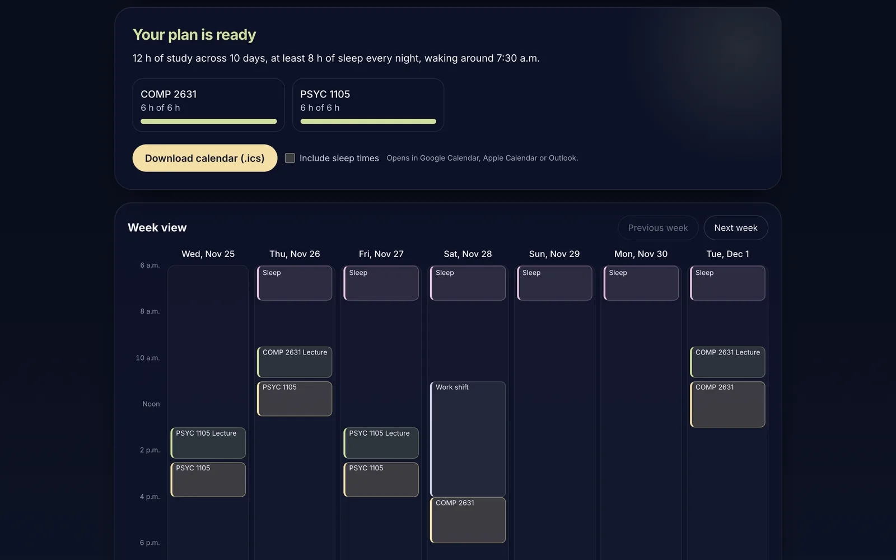
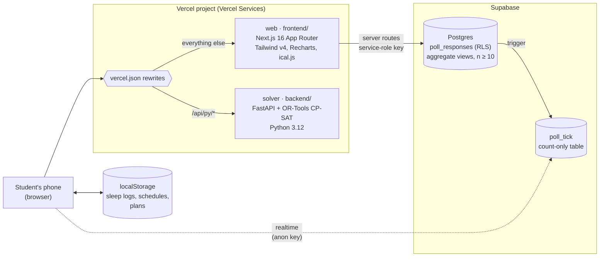

<div align="center">



# Sleep Smart MRU

**Sleep tools for Mount Royal University students: an alertness forecast, a sleep-safe exam
planner, and an anonymous campus poll. Built to turn sleep *knowledge* into sleep *action*.**

### [▶ Try it live: sleep-smart-mru.vercel.app](https://sleep-smart-mru.vercel.app)

Launched to MRU students in November 2026 · works on any phone or laptop · no account or download




</div>

## About

At Mount Royal University, **33% of students said sleep hurt their academic performance**, alongside
stress (46%) and anxiety (38%) (NCHA 2019, as reported by MRU Wellness Services, 2021). Most
students already know they should sleep 7 to 9 hours. The research gap is *doing* it:
information alone rarely changes sleep habits (Blunden et al., 2012), but short, personalized
online tools can (Hershner & O'Brien, 2018).

Sleep Smart MRU is my answer to that gap. It's a mobile-first web app that students open from a
QR code on campus posters, with no account and no download. It was built for **UGST 1002,
*Advocating for Change*** at Mount Royal University (Calgary, Fall 2026), a four-person group
project with Avalin, Liv and Ozzy. **I designed and built the whole app**: the front end, the
optimization service, the database and privacy design, testing and deployment.

**It's live and in real use.** We launched it to Mount Royal students in November 2026, and
students have been using it since launch.

## Try it yourself

Open **[sleep-smart-mru.vercel.app](https://sleep-smart-mru.vercel.app)** on your phone or
laptop. There's no sign-up, and everything you enter stays in your own browser except the
anonymous poll answers.

| Tool | Link | What to try |
| --- | --- | --- |
| Sleep guide | [/learn](https://sleep-smart-mru.vercel.app/learn) | Take the habit quiz, then check the caffeine calculator |
| Sleep Weather | [/forecast](https://sleep-smart-mru.vercel.app/forecast) | Add an exam for tomorrow morning and drag the bedtime slider |
| Exam-crunch planner | [/plan](https://sleep-smart-mru.vercel.app/plan) | Add two exams and build a plan; try a study load that can't fit |
| Sleep barrier poll | [/poll](https://sleep-smart-mru.vercel.app/poll) | Look at the three questions; it's for MRU students, so please don't submit, to keep the results real |
| Live dashboard | [/dashboard](https://sleep-smart-mru.vercel.app/dashboard) | See the poll results update live |
| How the forecast works | [/forecast/how-it-works](https://sleep-smart-mru.vercel.app/forecast/how-it-works) | The model, its parameters and their sources |

## What it does

| Sleep Weather | Exam-crunch planner | Sleep guide | Caffeine calculator |
| :---: | :---: | :---: | :---: |
|  |  |  |  |

- **Sleep Weather: an alertness forecast.** Log a week of sleep and add classes by hand or import
  an `.ics` calendar. The app forecasts tomorrow's alertness every 15 minutes with a published
  sleep-science model, and warns you when an exam lands in a slump. A slider shows what a later
  bedtime does to tomorrow, live.
- **Exam-crunch planner.** Enter your exams and the study hours each needs. A constraint solver
  builds a study plan around your classes and shifts that **never schedules less than 7 hours of
  sleep**. If the load can't fit, it explains why and offers options instead of cutting sleep.
  Plans export to `.ics` and Google Calendar.
- **Sleep barrier poll and live dashboard.** Three anonymous questions that take under a minute.
  Results stream live to a committee dashboard and a projector view, so MRU can see which
  barriers to fix first.
- **Sleep guide.** Habits that help and hurt, a quiz, an interactive night-of-sleep chart, a
  caffeine half-life calculator, and 20 studies summarized in plain language, each linked to its
  source.

<table>
  <tr>
    <td width="62%"></td>
    <td width="38%"></td>
  </tr>
  <tr>
    <td colspan="2"></td>
  </tr>
</table>

<sub>The poll screenshot uses the app's built-in, clearly labelled fake demo data.</sub>

## Engineering highlights

**Constraint optimization with a hard health guarantee.** The planner
([`backend/app/solver.py`](backend/app/solver.py)) is a Google OR-Tools CP-SAT model over
30-minute slots for up to 14 days. Every night gets exactly one contiguous sleep block of at least
7 hours with a steady wake time, as a hard constraint that's never relaxed. The objective balances
study placement, fragmentation and a consistent routine. When the input is infeasible, a separate
diagnosis step ([`diagnose.py`](backend/app/diagnose.py)) reports the shortfall per course and
concrete fixes (start earlier, raise the daily cap, move an optional event). A capacity pre-check
rejects impossible loads instantly, and the solver runs deterministically on a single thread with
a 5-second limit to fit inside a serverless request.

**A scientific model, implemented as pure and tested code.**
[`frontend/lib/alertness.ts`](frontend/lib/alertness.ts) implements the three-process model of
alertness (sleep pressure, circadian rhythm, sleep inertia). Every numeric parameter carries a
comment quoting its published source, and anything I couldn't verify is marked
`TODO(verify)` instead of guessed. The model personalizes to the user's body-clock timing using
the Munich ChronoType approach, and judges "low" against each user's own week instead of a
fixed threshold.

**Time zones and calendars done carefully.** Everything runs in `America/Edmonton` with
offset-aware ISO strings. `.ics` import parses recurring events (RRULE, VTIMEZONE) entirely on
the device with ical.js. While testing, the phone and the server turned out to ship different
time-zone database versions that disagree about Alberta's offset, so the client now sends its
own day boundaries to the solver. A regression test covers a 25-hour daylight-saving day.

**Privacy by design for the poll.** No accounts, names, emails, free text or IP addresses.
Writes go only through a Next.js server route holding the Supabase service-role key. Postgres
row-level security blocks direct access, and the public reads only aggregate views that hide any
breakdown with fewer than 10 people. Duplicate votes are limited by a hashed device token, and
rate limiting uses an HMAC of the IP with a key that rotates daily. Live updates come from a
count-only realtime table, so the browser never subscribes to response rows.

**Two runtimes, one deploy.** A Next.js app and a Python FastAPI service ship as one Vercel
project using Vercel Services, routed by path (`/api/py/*` → Python). The poll degrades safely:
in-memory in local dev, and an explicit "not connected" state in production rather than silently
dropping votes.

**Quality.** 63 Vitest tests (model maths, calendar import, time zones, exports, poll
validation and aggregation) and 17 pytest tests (sleep never under 7 h, no overlaps, required
hours met, infeasible input explained, determinism, DST). TypeScript strict mode and ESLint. The UI is mobile-first and accessible: keyboard support, visible focus,
WCAG AA contrast checked against the palette, screen-reader tables for charts, and
`prefers-reduced-motion` respected.

**Craft.** The night-sky hero is drawn on a canvas with procedural noise and a seamless looping
starfield. The moon is rendered offline by a deterministic script with real maria and crater
positions ([`render-moon.mts`](frontend/scripts/render-moon.mts)). All 30 research sources were
checked against their Crossref and PubMed records before going into the app's APA reference list.

## Architecture



Personal data (sleep logs, schedules, plans) never leaves the device; it lives in validated,
versioned localStorage. Only anonymous poll answers reach the database.

## Tech stack

| Layer | Tools |
| --- | --- |
| Front end | Next.js 16 (App Router, cache components), React 19, TypeScript, Tailwind CSS v4, Recharts, ical.js |
| Optimization service | Python 3.12, FastAPI, Pydantic, Google OR-Tools CP-SAT, uv |
| Data | Supabase Postgres with row-level security, SQL views, triggers and realtime |
| Testing | Vitest, pytest, ESLint, TypeScript |
| Hosting | Vercel (Services beta: Next.js and Python in one project) |

## Repository layout

```text
frontend/            Next.js app
  app/               routes: /, /forecast, /plan, /poll, /dashboard, /present, /learn, /about, /status, /api/*
  components/        UI by feature (forecast, plan, poll, learn, sky, home)
  lib/               pure logic + tests: alertness model, chronotype, ics import, time, plan, poll, references
  scripts/           moon and icon renderers, demo-data seeder
backend/             FastAPI + CP-SAT study planner
  app/               main.py (routes), schemas.py, slots.py, solver.py, diagnose.py
  tests/             pytest suite
supabase/migrations/ poll schema, RLS, views, realtime trigger, grants
docs/                proposal, presenter guide, demo script, Supabase setup, screenshots
vercel.json          service definitions and path routing
```

## Run it locally

You need Node 22.18 or newer, Python 3.12 with [uv](https://docs.astral.sh/uv/), and the Vercel CLI
(`npm i -g vercel`).

```bash
git clone https://github.com/ayan759/sleep-smart-mru.git
cd sleep-smart-mru
npm --prefix frontend install
(cd backend && uv sync --extra dev)
cp .env.example frontend/.env.local   # optional locally: without Supabase keys the poll uses memory
npm run dev:services                  # both services at http://localhost:3000
```

| Command (repo root) | What it does |
| --- | --- |
| `npm run dev:services` | Next.js and FastAPI together via `vercel dev -L` |
| `npm run lint` | ESLint and TypeScript (front end), compile check (back end) |
| `npm test` | Vitest, then pytest |
| `npm run build` | Production build of the Next.js app |

### Environment variables

| Variable | Scope | Purpose |
| --- | --- | --- |
| `SUPABASE_URL` | server, shared with browser for realtime | Supabase project URL |
| `SUPABASE_ANON_KEY` | server, shared with browser for realtime | Publishable key; RLS protects the data |
| `SUPABASE_SERVICE_ROLE_KEY` | **server only** | Secret key for poll writes; never `NEXT_PUBLIC_` |
| `ADMIN_PASSCODE` | **server only** | Protects the dashboard's reset and demo-data tools |

Database setup is in [`docs/supabase-setup.md`](docs/supabase-setup.md) (run the two SQL files
in `supabase/migrations/`). Deploy with `vercel deploy --prod` from the repo root.

## Safety and privacy

- **Not a medical tool.** It gives educational estimates, never diagnoses or suggests medication,
  and points students to MRU Health Services and Wellness Services. If someone logs under 5 hours
  on most nights, a gentle note suggests support.
- **The planner never schedules under 7 hours of sleep**, for any input.
- **Anonymous poll:** one response per device (hashed token), no personal data, groups under 10
  are hidden, and demo data is always labelled "Demo data".

## The science

Sleep Weather uses the three-process model of alertness (Åkerstedt & Folkard, 1997), built on
the two-process model of sleep regulation (Borbély, 1982; Daan et al., 1984), with the equations
and values restated by Ingre et al. (2014). Body-clock timing follows Roenneberg et al. (2003,
2004). Sleep guidance follows the Canadian 24-Hour Movement Guidelines (Ross et al., 2020) and
Health Canada's caffeine guidance. Three model details I couldn't confirm from the original papers
are marked `TODO(verify)` in [`alertness.ts`](frontend/lib/alertness.ts) and
[`chronotype.ts`](frontend/lib/chronotype.ts) rather than guessed.

<details>
<summary><strong>Full reference list (APA 7, 30 sources)</strong></summary>

Generated from [`frontend/lib/references.ts`](frontend/lib/references.ts); each entry was checked
against its Crossref and PubMed record (web pages against the page itself) on 2026-11-24. The same
list is on the app's [About page](https://sleep-smart-mru.vercel.app/about#references).

- Åkerstedt, T., & Folkard, S. (1997). The three-process model of alertness and its extension to performance, sleep latency, and sleep length. *Chronobiology International, 14*(2), 115–123. https://doi.org/10.3109/07420529709001149
- Åkerstedt, T., Folkard, S., & Portin, C. (2004). Predictions from the three-process model of alertness. *Aviation, Space, and Environmental Medicine, 75*(3, Suppl.), A75–A83. https://pubmed.ncbi.nlm.nih.gov/15018267/
- Blunden, S. L., Chapman, J., & Rigney, G. A. (2012). Are sleep education programs successful? The case for improved and consistent research efforts. *Sleep Medicine Reviews, 16*(4), 355–370. https://doi.org/10.1016/j.smrv.2011.08.002
- Borbély, A. A. (1982). A two process model of sleep regulation. *Human Neurobiology, 1*(3), 195–204. https://pubmed.ncbi.nlm.nih.gov/7185792/
- Brown, F. C., Buboltz, W. C., Jr., & Soper, B. (2002). Relationship of sleep hygiene awareness, sleep hygiene practices, and sleep quality in university students. *Behavioral Medicine, 28*(1), 33–38. https://doi.org/10.1080/08964280209596396
- Chang, A.-M., Aeschbach, D., Duffy, J. F., & Czeisler, C. A. (2015). Evening use of light-emitting eReaders negatively affects sleep, circadian timing, and next-morning alertness. *Proceedings of the National Academy of Sciences, 112*(4), 1232–1237. https://doi.org/10.1073/pnas.1418490112
- Daan, S., Beersma, D. G., & Borbély, A. A. (1984). Timing of human sleep: Recovery process gated by a circadian pacemaker. *American Journal of Physiology–Regulatory, Integrative and Comparative Physiology, 246*(2), R161–R183. https://doi.org/10.1152/ajpregu.1984.246.2.R161
- Drake, C., Roehrs, T., Shambroom, J., & Roth, T. (2013). Caffeine effects on sleep taken 0, 3, or 6 hours before going to bed. *Journal of Clinical Sleep Medicine, 9*(11), 1195–1200. https://doi.org/10.5664/jcsm.3170
- Ebrahim, I. O., Shapiro, C. M., Williams, A. J., & Fenwick, P. B. (2013). Alcohol and sleep I: Effects on normal sleep. *Alcoholism: Clinical and Experimental Research, 37*(4), 539–549. https://doi.org/10.1111/acer.12006
- Exelmans, L., & Van den Bulck, J. (2016). Bedtime mobile phone use and sleep in adults. *Social Science & Medicine, 148*, 93–101. https://doi.org/10.1016/j.socscimed.2015.11.037
- Health Canada. (2025, April 2). *Caffeine in foods*. Government of Canada. https://www.canada.ca/en/health-canada/services/food-nutrition/food-safety/food-additives/caffeine-foods.html
- Health Canada. (2026, November 20). *Caffeinated energy drinks*. Government of Canada. https://www.canada.ca/en/health-canada/services/food-nutrition/supplemented-foods/caffeinated-energy-drinks.html
- Hershner, S. D., & Chervin, R. D. (2014). Causes and consequences of sleepiness among college students. *Nature and Science of Sleep, 6*, 73–84. https://doi.org/10.2147/NSS.S62907
- Hershner, S., & O'Brien, L. M. (2018). The impact of a randomized sleep education intervention for college students. *Journal of Clinical Sleep Medicine, 14*(3), 337–347. https://doi.org/10.5664/jcsm.6974
- Ingre, M., Van Leeuwen, W., Klemets, T., Ullvetter, C., Hough, S., Kecklund, G., Karlsson, D., & Åkerstedt, T. (2014). Validating and extending the three process model of alertness in airline operations. *PLOS ONE, 9*(10), Article e108679. https://doi.org/10.1371/journal.pone.0108679
- Kredlow, M. A., Capozzoli, M. C., Hearon, B. A., Calkins, A. W., & Otto, M. W. (2015). The effects of physical activity on sleep: A meta-analytic review. *Journal of Behavioral Medicine, 38*(3), 427–449. https://doi.org/10.1007/s10865-015-9617-6
- Kuhn, T., Karsan, S., Heisz, J. J., & Middleton, L. E. (2024). The differing relationships between academic discipline, sleep hygiene, and dysfunctional sleep attitudes on sleep quality and duration in Canadian university students. *Frontiers in Psychology, 15*, Article 1396579. https://doi.org/10.3389/fpsyg.2024.1396579
- Lund, H. G., Reider, B. D., Whiting, A. B., & Prichard, J. R. (2010). Sleep patterns and predictors of disturbed sleep in a large population of college students. *Journal of Adolescent Health, 46*(2), 124–132. https://doi.org/10.1016/j.jadohealth.2009.06.016
- Mednick, S., Nakayama, K., & Stickgold, R. (2003). Sleep-dependent learning: A nap is as good as a night. *Nature Neuroscience, 6*(7), 697–698. https://doi.org/10.1038/nn1078
- National Institute of Neurological Disorders and Stroke. (2025, February 25). *Brain basics: Understanding sleep*. National Institutes of Health. https://www.ninds.nih.gov/health-information/public-education/brain-basics/brain-basics-understanding-sleep
- Okano, K., Kaczmarzyk, J. R., Dave, N., Gabrieli, J. D. E., & Grossman, J. C. (2019). Sleep quality, duration, and consistency are associated with better academic performance in college students. *npj Science of Learning, 4*, Article 16. https://doi.org/10.1038/s41539-019-0055-z
- Phillips, A. J. K., Clerx, W. M., O'Brien, C. S., Sano, A., Barger, L. K., Picard, R. W., Lockley, S. W., Klerman, E. B., & Czeisler, C. A. (2017). Irregular sleep/wake patterns are associated with poorer academic performance and delayed circadian and sleep/wake timing. *Scientific Reports, 7*, Article 3216. https://doi.org/10.1038/s41598-017-03171-4
- Roenneberg, T., Kuehnle, T., Pramstaller, P. P., Ricken, J., Havel, M., Guth, A., & Merrow, M. (2004). A marker for the end of adolescence. *Current Biology, 14*(24), R1038–R1039. https://doi.org/10.1016/j.cub.2004.11.039
- Roenneberg, T., Wirz-Justice, A., & Merrow, M. (2003). Life between clocks: Daily temporal patterns of human chronotypes. *Journal of Biological Rhythms, 18*(1), 80–90. https://doi.org/10.1177/0748730402239679
- Ross, R., Chaput, J.-P., Giangregorio, L. M., Janssen, I., Saunders, T. J., Kho, M. E., Poitras, V. J., Tomasone, J. R., El-Kotob, R., McLaughlin, E. C., Duggan, M., Carrier, J., Carson, V., Chastin, S. F., Latimer-Cheung, A. E., Chulak-Bozzer, T., Faulkner, G., Flood, S. M., Gazendam, M. K., . . . Tremblay, M. S. (2020). Canadian 24-Hour Movement Guidelines for Adults aged 18–64 years and Adults aged 65 years or older: An integration of physical activity, sedentary behaviour, and sleep. *Applied Physiology, Nutrition, and Metabolism, 45*(10, Suppl. 2), S57–S102. https://doi.org/10.1139/apnm-2020-0467
- Thacher, P. V. (2008). University students and the “all nighter”: Correlates and patterns of students’ engagement in a single night of total sleep deprivation. *Behavioral Sleep Medicine, 6*(1), 16–31. https://doi.org/10.1080/15402000701796114
- Van Dongen, H. P. A., Maislin, G., Mullington, J. M., & Dinges, D. F. (2003). The cumulative cost of additional wakefulness: Dose-response effects on neurobehavioral functions and sleep physiology from chronic sleep restriction and total sleep deprivation. *Sleep, 26*(2), 117–126. https://doi.org/10.1093/sleep/26.2.117
- Williamson, A. M., & Feyer, A.-M. (2000). Moderate sleep deprivation produces impairments in cognitive and motor performance equivalent to legally prescribed levels of alcohol intoxication. *Occupational and Environmental Medicine, 57*(10), 649–655. https://doi.org/10.1136/oem.57.10.649
- Wittmann, M., Dinich, J., Merrow, M., & Roenneberg, T. (2006). Social jetlag: Misalignment of biological and social time. *Chronobiology International, 23*(1–2), 497–509. https://doi.org/10.1080/07420520500545979
- Yoo, S.-S., Gujar, N., Hu, P., Jolesz, F. A., & Walker, M. P. (2007). The human emotional brain without sleep—A prefrontal amygdala disconnect. *Current Biology, 17*(20), R877–R878. https://doi.org/10.1016/j.cub.2007.08.007

The MRU figures are cited as NCHA 2019, as reported by MRU Wellness Services (2021); we couldn't
find a public copy of that report to link to.

</details>

## Project docs

- [`docs/step-0-proposal.md`](docs/step-0-proposal.md): the original plan and scope
- [`docs/sleep-weather-presenter-guide.md`](docs/sleep-weather-presenter-guide.md): explaining
  the forecast to a non-technical audience
- [`docs/demo-script.md`](docs/demo-script.md): the 3-minute live demo
- [`docs/supabase-setup.md`](docs/supabase-setup.md): database setup

## Team

Built for UGST 1002, *Advocating for Change*, at Mount Royal University by **Avalin, Liv, Ayan
and Ozzy**. App design and development: **Ayan** ([@ayan759](https://github.com/ayan759)).
